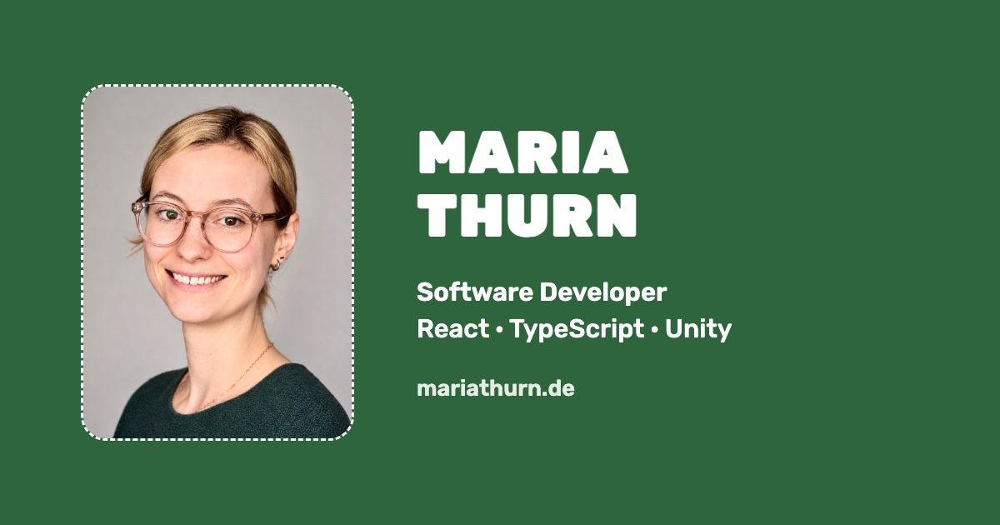

# Maria Thurn – Portfolio

**Live: [mariathurn.de](https://mariathurn.de)**



My personal portfolio: a single-page site that introduces me as a software developer with a background in
graphic design, and shows my projects in interactive slideshows.

Built with **React 19**, **TypeScript** and **Vite**, styled with plain CSS. No UI library, no animation
library, no runtime dependencies besides React.

## Highlights

- **Skill runner game** – the Skills section is a small side-scrolling game on `<canvas>`: a pixel wizard
  jumps over bugs and collects skill bubbles. Retro sound effects are synthesised with the Web Audio API,
  without audio files. A plain table lists the same skills for anyone who'd rather not play.
- **Project slideshows** – one reusable `ProjectStory` dialog with arrow buttons, arrow keys,
  swipe on touch screens, dots and deep links (`/#almsommer`, `/#husk`). Slides can hold live demos, e.g. a hand of cards that
  re-sorts its trumps when you pick a different game, or a review card that flips over.
- **Character sheet** – the About section is written as a tabletop RPG character sheet, with an SVG
  pixel portrait drawn from a sprite map.
- **Light and dark mode** – follows the device setting until the visitor flips the lever in the navbar.
  The theme is applied before React loads, so there is no flash of the wrong colours.
- **Accessible** – semantic headings and landmarks, labelled controls, native `<dialog>` for modals
  (focus handling and Esc for free), keyboard support throughout and `prefers-reduced-motion` respected.
- **Responsive** – layouts adapt from phone to wide screens; the navbar colour follows the section in
  view (`IntersectionObserver`).

## Getting started

Requires Node.js 20.19 or newer (for Vite 8).

```bash
npm install
npm run dev      # start the dev server
npm run build    # type-check and build for production (output in dist/)
npm run preview  # preview the production build
npm run lint     # run ESLint
```

## Project structure

```
src/
  components/   # One component per section, plus the slideshows and the skill game
  data/         # Skills, card deck and pixel sprites as plain data
  styles/       # One stylesheet per component; global.css holds the shared design tokens
  assets/       # Images, screenshots, CV and thesis
  sound.ts      # Web Audio sound effects for the game
public/         # Favicons, social preview image, privacy page, robots.txt and sitemap
```

## Projects shown on the site

- **Almsommer** – the Bavarian card game Schafkopf for Android, iOS and the web, with my own illustrated
  deck. [Play in the browser](https://almsommer.mariathurn.de/)
- **Husk** – an offline-first app for learning Danish vocabulary with spaced repetition.
- **Donut Wars** – a 2D survival game made in Unity. [Play on itch.io](https://mariagamingcorner.itch.io/donut-wars)
- **Master's thesis** – how multilingual transformer models represent named entities.

## Contact

[mail@mariathurn.de](mailto:mail@mariathurn.de) · [LinkedIn](https://www.linkedin.com/in/maria-thurn-134421142/)

---

© 2026 Maria Thurn. The photos, illustrations and artwork in this repository are my own and may not be
reused without permission.
