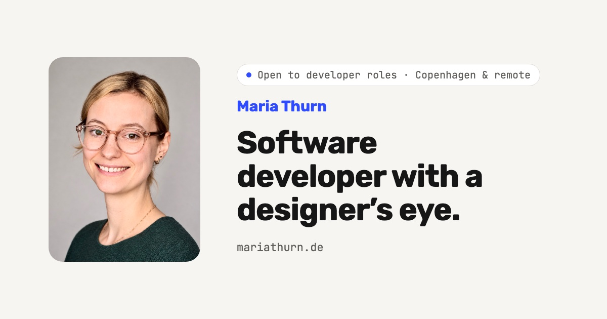

# Maria Thurn – Portfolio

**Live: [mariathurn.de](https://mariathurn.de)**



My personal portfolio: a small multi-page site that introduces me as a software developer with a background
in graphic design. Projects come first; everything else follows.

Built with **React 19**, **TypeScript** and **Vite**, styled with plain CSS. No UI library, no animation
library, no runtime dependencies besides React.

## Pages

| Page | URL | Entry |
|---|---|---|
| Home: hero, selected work, how I work, about, contact | `/` | `index.html` → `src/main.tsx` |
| Case study: Schafi | `/work/schafi/` | `work/schafi/index.html` → `src/schafi.tsx` |

Each page is its own HTML file (Vite multi-page build), so the URLs work on any static host without rewrites.

Deep links: `/#husk` and `/#almsommer` open the slideshows on the home page.

## Highlights

- **Design tokens** – colours, type, spacing and shared components live in `src/styles/tokens.css`.
  Every text colour passes WCAG AA in light and dark mode.
- **Light and dark mode** – follows the device setting; the toggle in the navbar overrides it and is
  remembered. `public/theme-init.js` applies the theme before React loads, so there is no flash.
- **Slideshows** (Husk, Almsommer) – a reusable `ProjectStory` dialog with arrow buttons, arrow keys, swipe,
  dots and live demos (a review card that flips over, the whole illustrated deck with a lightbox).
- **Accessible** – semantic headings and landmarks, 44px touch targets, visible focus, native `<dialog>`,
  keyboard support throughout and `prefers-reduced-motion` respected.

## Getting started

Requires Node.js 20.19 or newer (for Vite 8).

```bash
npm install
npm run dev      # start the dev server
npm run build    # type-check and build for production (output in dist/)
npm run preview  # preview the production build
npm run lint     # run ESLint
```

## Project structure

```
src/
  components/   # Page sections, the Schafi case study and the Husk slideshow
  styles/       # tokens.css (design tokens), site.css (layout), one file per slideshow
  assets/       # Images, screenshots, CV and thesis
work/schafi/    # HTML entry of the case study
public/         # Favicons, theme script, social preview image, privacy page, robots.txt and sitemap
```

## Projects shown on the site

- **Schafi** – the Bavarian card game Schafkopf for Android, iOS and the web, online with friends or against
  computer players that think ahead. [Play in the browser](https://schafi.app/spielen/) ·
  [Case study](https://mariathurn.de/work/schafi/)
- **Almsommer** – the first version of the game, with a deck of 24 cards I illustrated myself and a layout
  that adapts from phone to wide screen.
- **Husk** – an offline-first app for learning Danish vocabulary with spaced repetition.
- **Donut Wars** – a 2D survival game made in Unity. [Play on itch.io](https://mariagamingcorner.itch.io/donut-wars)
- **Master's thesis** – how multilingual transformer models represent named entities.

## Contact

[mail@mariathurn.de](mailto:mail@mariathurn.de) · [LinkedIn](https://www.linkedin.com/in/maria-thurn-134421142/)

---

© 2026 Maria Thurn. The photos, illustrations and artwork in this repository are my own and may not be
reused without permission.
